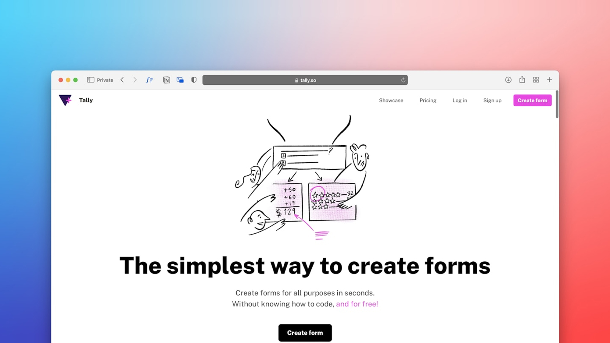
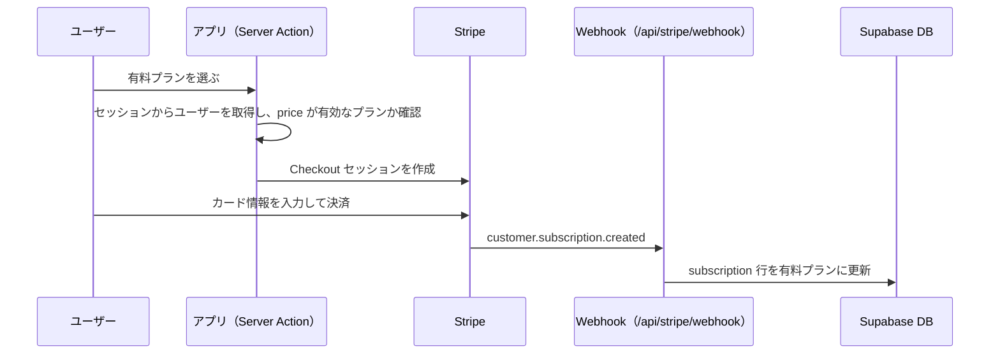

<div align="center">

# しゃべる台本

台本を作成・編集して、プロンプターとして自動スクロール表示できる Web アプリ<br/>
（Next.js / Supabase / Stripe の学習を兼ねて開発）



</div>

<p align="center">
  <a href="#-主な機能">主な機能</a> /
  <a href="#-技術スタック">技術スタック</a> /
  <a href="#-ローカル環境のセットアップ">セットアップ</a> /
  <a href="#-開発">開発</a> /
  <a href="#-テスト">テスト</a> /
  <a href="#-仕組み設計ルール">仕組み・設計ルール</a> /
  <a href="#-本番デプロイ">本番デプロイ</a>
</p>

---

## ✨ 主な機能

- **台本の作成・編集**：リッチテキストエディタ（Tiptap）で台本を書き、タイトル・本文を自動保存
- **プロンプター表示**：自動スクロール（速度調整）、文字サイズ・行間の変更、左右／上下の反転（鏡文字）、開始前のカウントダウン
- **台本の管理**：一覧の並び替え（作成日・更新日・お気に入り優先）、お気に入り登録、削除
- **アカウント**：メール＋パスワードでの登録・ログイン、パスワード再設定、プロフィール（名前・アバター画像）の編集、アカウント削除
- **サブスクリプション**：Stripe によるプラン購入・変更・解約・解約の取り消し

### プラン

| プラン       | 台本の作成数 |
| ------------ | ------------ |
| フリー       | 1 件まで     |
| スタンダード | 50 件まで    |
| プレミアム   | 無制限       |

プランの定義は DB の `plan` テーブルで管理しています（ローカルでは `supabase/seed.sql` で投入）。

---

## 🔧 技術スタック

- **Framework**: Next.js (App Router) / React 19
- **Language**: TypeScript
- **Styling**: Tailwind CSS
- **State Management**: Jotai
- **Editor**: Tiptap
- **Backend / Auth / Storage**: Supabase
- **Payment**: Stripe（Checkout / Subscriptions / Webhook）
- **Test**: Vitest（ユニット）/ Playwright（E2E）
- **Lint / Formatter**: ESLint / Prettier（husky + lint-staged）
- **Package Manager**: pnpm

---

## 📋 前提ツール

| ツール                                                                                 | 用途                                                 |
| -------------------------------------------------------------------------------------- | ---------------------------------------------------- |
| Node.js 22 系 / pnpm 10 系                                                             | アプリの実行                                         |
| [Docker Desktop](https://www.docker.com/products/docker-desktop/)                      | ローカルの Supabase を動かす（起動しておく必要あり） |
| [Supabase CLI](https://supabase.com/docs/guides/local-development/cli/getting-started) | ローカル DB の起動・migration の管理                 |
| [Stripe CLI](https://docs.stripe.com/stripe-cli/install)                               | Webhook をローカルに転送する                         |

---

## 🚀 ローカル環境のセットアップ

#### 1. リポジトリをクローンして依存関係をインストール

```bash
git clone https://github.com/yagokakeru/subscription-domo-app.git
cd subscription-domo-app
pnpm install
```

#### 2. ローカルの Supabase を起動

Docker Desktop を起動した状態で実行します。初回はイメージのダウンロードに数分かかります。

```bash
supabase start
```

最後に表示される `API URL`・`anon key`・`service_role key` を手順4で使います。初回起動時に `supabase/migrations/` と `supabase/seed.sql` が適用されます。

#### 3. Stripe（テストモード）の準備

1. Stripe ダッシュボードを**テストモード**にし、シークレットキー（`sk_test_...`）を控える
2. 有料プラン用の商品と価格（月額）を作成し、価格 ID（`price_...`）を控える
3. `supabase/seed.sql` の `stripe_price_id` を、**自分のアカウントで作成した価格 ID** に書き換え、`supabase db reset` で投入し直す

#### 4. 環境変数を設定

```bash
cp .env.example .env.local
```

```env
NEXT_PUBLIC_APP_URL=http://localhost:3000

NEXT_PUBLIC_SUPABASE_URL=http://127.0.0.1:54321   # supabase start の API URL
NEXT_PUBLIC_SUPABASE_ANON_KEY=                    # supabase start の anon key
SUPABASE_SERVICE_ROLE_KEY=                        # supabase start の service_role key

STRIPE_SECRET_KEY=                                # sk_test_...
STRIPE_WEBHOOK_SECRET=                            # 手順5で表示される whsec_...
```

> [!WARNING]
> `SUPABASE_SERVICE_ROLE_KEY`・`STRIPE_SECRET_KEY`・`STRIPE_WEBHOOK_SECRET` には `NEXT_PUBLIC_` を付けないでください。付けるとブラウザに公開されます。

#### 5. Stripe の Webhook をローカルに転送

```bash
stripe login
stripe listen --forward-to localhost:3000/api/stripe/webhook
```

表示された signing secret（`whsec_...`）を `.env.local` の `STRIPE_WEBHOOK_SECRET` に設定します。決済まわりを動かしている間は、このコマンドを起動したままにしてください。

#### 6. 開発サーバーを起動

```bash
pnpm dev
```

| URL                    | 内容                                                                               |
| ---------------------- | ---------------------------------------------------------------------------------- |
| http://localhost:3000  | アプリ                                                                             |
| http://localhost:54323 | Supabase Studio（ローカル DB の管理画面）                                          |
| http://localhost:54324 | メール確認用の画面（サインアップの確認メール・パスワード再設定メールはここに届く） |

---

## 🧑‍💻 開発

### DB（Supabase migration）

DB の構成（テーブル・RLS ポリシー・関数・ビュー・Storage バケットなど）は `supabase/migrations/` の SQL ファイルで管理します。
**ダッシュボードで直接変更せず、必ず migration ファイル経由で変更してください。** 開発用と本番の DB の構成がずれるのを防ぐためです。

#### ローカル DB の操作

```bash
supabase start       # 起動（初回だけ migrations と seed.sql が適用される）
supabase stop        # 停止（データは次回起動時まで残る）
supabase db reset    # 全 migration と seed.sql を最初から適用し直す
```

#### DB の構成を変更するとき

```bash
# 1. migration ファイルを作成
supabase migration new <変更内容がわかる名前>   # 例: add_plan_sort_order

# 2. 作成された supabase/migrations/<日時>_<名前>.sql に SQL を書く

# 3. ローカル DB を作り直して確認
supabase db reset

# 4. 問題なければリモートの DB に反映
supabase link --project-ref <反映先のproject-ref>
supabase db push
```

- migration ファイルは一度 push したら編集せず、修正が必要なときは新しい migration ファイルを追加してください。
- `supabase/seed.sql` はローカル DB 専用です（`db push` では適用されません）。

#### 注意点

- `supabase/config.toml` の `[db] major_version` は、リモート DB の Postgres のバージョンに合わせてください（現在は `15`）。違うと `supabase db pull` などが `error running container: exit 1` で失敗します。
- `supabase db pull` でリモートから差分を取り込んだときは、生成された SQL を必ず確認してください。`storage` スキーマのトリガー（`drop trigger ... on "storage"."prefixes"` など）が含まれていると、`must be owner of relation ...` エラーで適用できません。これらは Supabase 側が管理しているものなので削除してください。`storage.objects` の RLS ポリシー（`create policy`）は残します。

### Lint / Format

```bash
pnpm lint        # ESLint（コード品質チェック）
pnpm prettier    # Prettier（フォーマット）
```

- ESLint：ロジック・バグの検出／Prettier：コード整形
- 保存時：ESLint → Prettier の順で自動実行
- commit 時：husky + lint-staged により、差分のファイルだけ `eslint --fix` と `prettier --write` が自動実行される

---

## 🧪 テスト

```bash
pnpm test         # ユニットテスト（Vitest）
pnpm test:watch   # ユニットテスト（ファイル変更を監視）
pnpm test:e2e     # E2E テスト（Playwright）
```

- **ユニットテスト**：Server Actions などを、Supabase・Stripe をモックしてテストします。外部サービスは不要です。
- **E2E テスト**：開発サーバーを自動で起動し、`.env.local` の接続先（ローカルの Supabase）に対して実行します。事前に `supabase start` しておいてください。
- **決済まわりの手動テスト**：[`docs/stripe_manual_test_checklist.xlsx`](./docs/stripe_manual_test_checklist.xlsx) のチェックリストに沿って確認します。解約の確定（期間終了）は Stripe の Test Clocks、またはダッシュボードの「今すぐキャンセル」で再現します。

> [!NOTE]
> `stripe trigger customer.subscription.created` などで発火したイベントは、`metadata.user_id` を持たないダミーのサブスクリプションのため、DB は更新されません。Webhook を受信できるかの疎通確認にだけ使えます。

---

## 🧭 仕組み・設計ルール

### 決済の流れ



| 操作                      | 処理                                                                                | DB への反映                                                                               |
| ------------------------- | ----------------------------------------------------------------------------------- | ----------------------------------------------------------------------------------------- |
| 新規購入（フリー → 有料） | `checkout()` で Stripe Checkout へ                                                  | `customer.subscription.created` の Webhook                                                |
| プラン変更（有料 → 有料） | `UpgradeSubscription()` で price を変更（日割り請求）。解約予定中なら同時に取り消す | Server Action 内で即時更新＋`customer.subscription.updated` の Webhook                    |
| 解約                      | `Unsubscription()` で期間終了時に解約（`cancel_at_period_end = true`）              | Server Action 内で即時更新                                                                |
| 解約の取り消し            | `ReactivateSubscription()`                                                          | Server Action 内で即時更新                                                                |
| 解約の確定（期間終了）    | Stripe が自動で解約                                                                 | `customer.subscription.deleted` の Webhook で**フリープランの行に戻す**（行は削除しない） |
| アカウント削除            | Stripe 顧客を削除 → auth ユーザーを削除                                             | `profile`・`subscription`・`script` などは外部キーの `ON DELETE CASCADE` で削除           |

#### 処理している Webhook イベント

`checkout.session.completed` / `customer.subscription.created` / `customer.subscription.updated` / `customer.subscription.deleted` / `invoice.payment_succeeded` / `invoice.payment_failed`

#### 支払いに失敗したとき

カード決済に失敗したサブスクリプション（`past_due`）は、Stripe が再請求している間は**猶予期間としてそのまま利用可能**です。再請求がすべて失敗すると Stripe がサブスクリプションを解約し、Webhook によってフリープランに戻ります。再請求のスケジュールと失敗時のメールは、Stripe ダッシュボードの「Billing → Revenue recovery」で設定します。

### 台本の作成上限とロック

- **作成上限**は、Supabase の RLS（`script` テーブルの INSERT ポリシー）で制御しています。上限を超えた作成はエラー（`42501`）になり、アプリは「上限に達しています」と表示します。
- **ダウングレード後に上限を超えた台本**は削除せず、**作成日が新しい順に上限数までを利用可能**とし、残りをロックします。ロック中の台本は一覧に表示され、削除だけできます（編集・プロンプター表示・タイトル変更は不可）。
- ロックは表示・操作のたびに計算しており、DB には保存していません。再アップグレードすると自動で解除されます。

### セキュリティのルール

- **Server Action では、操作対象のユーザーを必ずセッションから取得します。** ユーザー ID・Stripe 顧客 ID・サブスクリプション ID をクライアントから引数で受け取らないでください（他人のデータを操作できてしまうため）。
- クライアントから受け取ってよいのは、ユーザーが選んだ値（例：購入するプランの price ID）だけです。その場合も、**サーバー側で有効な値か検証します**（例：`plan` テーブルに存在し、`is_active = true` か）。
- `subscription` テーブルへの書き込み（サインアップ時の作成を含む）は、**service role のクライアントからのみ**行います。RLS でユーザー本人からの書き込みは禁止しています。
- `profile` テーブルでユーザー本人が更新できるのは `name`・`avatar_url` だけです。

---

## 🌐 本番デプロイ

本番は Vercel・Supabase（本番用プロジェクト）・Stripe（本番モード）で構成します。

#### 1. Supabase（本番用プロジェクト）

```bash
supabase link --project-ref <本番のproject-ref>   # 接続先が本番で正しいか必ず確認
supabase db push                                  # migrations を本番 DB に適用
```

- `plan` テーブルのデータは、**Stripe 本番モードの価格 ID** で別途登録してください（`seed.sql` は本番には適用されません）。
- Authentication の **Site URL / Redirect URLs** を本番のドメインに設定してください。
- サインアップ時のメール確認は行わない仕様のため、Authentication → Sign In / Providers → Email の **「Confirm email」を OFF** にしてください（新規プロジェクトは初期値が ON です。ON のままだとサインアップ直後にセッションが作られず、そのまま決済へ進む流れが失敗します）。
- 初期設定のメール送信は送信数の制限が厳しいため、**カスタム SMTP** を設定してください。
- 認証メール（パスワード再設定・サインアップ確認など）の文面は `supabase/templates/*.html` を正本とし、本番にはダッシュボードの **Authentication → Email Templates** に内容を貼り付けて反映します（件名は `supabase/config.toml` の `[auth.email.template.*]` の `subject` に合わせる）。`supabase config push` は Site URL などローカル用の値も送ってしまうため使いません。

#### 2. Stripe（本番モード）

- 有料プランの商品・価格を作成し、価格 ID を本番 DB の `plan.stripe_price_id` に登録する
- Webhook エンドポイント（`https://<本番ドメイン>/api/stripe/webhook`）を登録し、[処理している Webhook イベント](#処理している-webhook-イベント)を選択する
- 「Billing → Revenue recovery」で、再請求のスケジュール（すべて失敗したらサブスクリプションを解約）と支払い失敗メールを設定する

#### 3. Vercel

Environment Variables に、[環境変数](#4-環境変数を設定)を本番の値で設定します。

- `NEXT_PUBLIC_APP_URL`：本番のドメイン
- Supabase：本番プロジェクトの URL・anon key・service_role key
- Stripe：本番モードのシークレットキー（`sk_live_...`）と、本番の Webhook の signing secret

---

## 📂 ディレクトリ構成（抜粋）

```
app/                    # Next.js App Router（ページ・API Route・Server Actions の一部）
  api/stripe/webhook/   # Stripe Webhook のエンドポイント
components/             # UI コンポーネント
lib/
  actions/              # Server Actions（台本・認証・Stripe）
  functions/            # サーバー側の共通処理（ユーザー・プラン情報の取得、台本のロック判定など）
  validation/           # フォームのバリデーション
types/                  # 型定義
utils/                  # Supabase / Stripe クライアントの生成
supabase/
  migrations/           # DB の構成（SQL）
  seed.sql              # ローカル DB の初期データ
  config.toml           # ローカル Supabase の設定
tests/                  # E2E テスト（Playwright）
docs/                   # 手動テストのチェックリスト、開発メモ（dev-notes.md）
proxy.ts                # 認証状態によるリダイレクト（Supabase のセッション更新）
eslint.config.mjs       # ESLint 設定
prettier.config.mjs     # Prettier 設定
```
